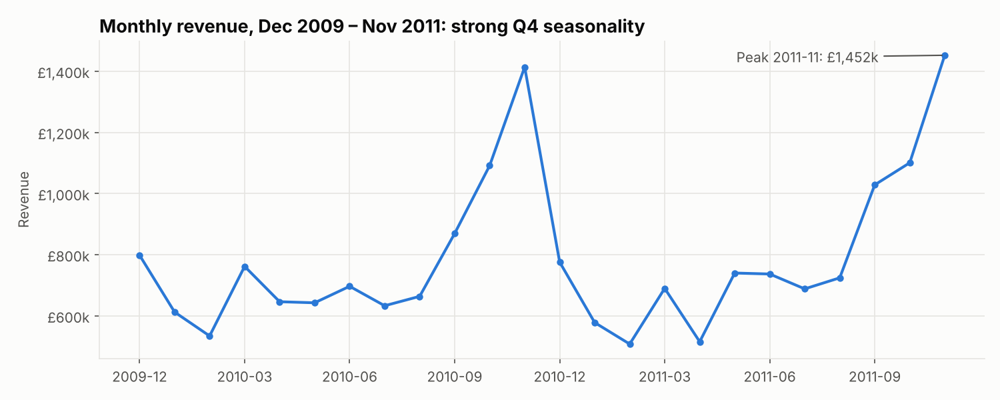
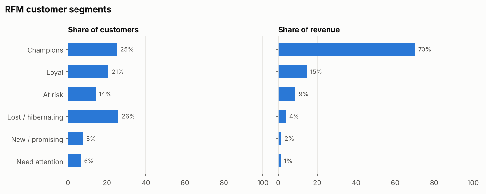
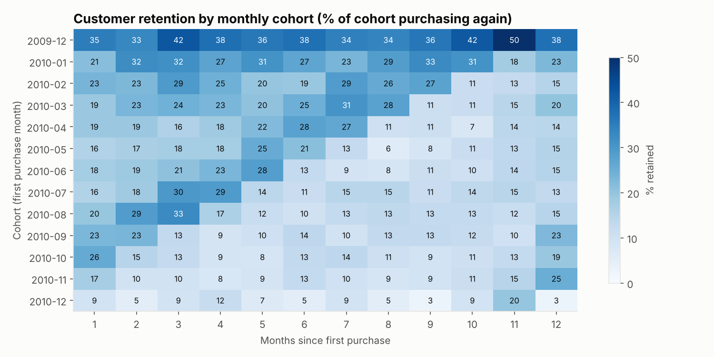
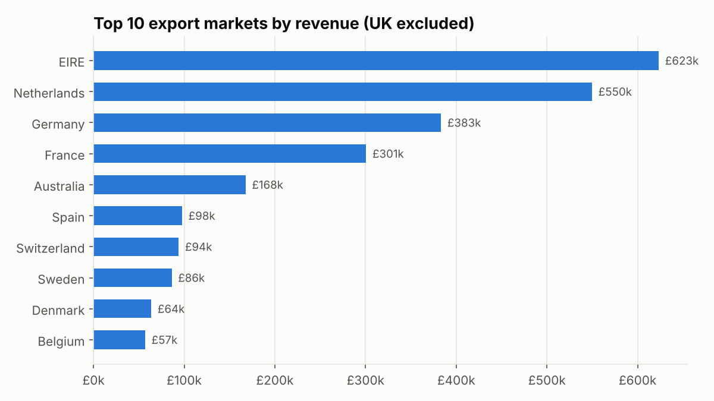
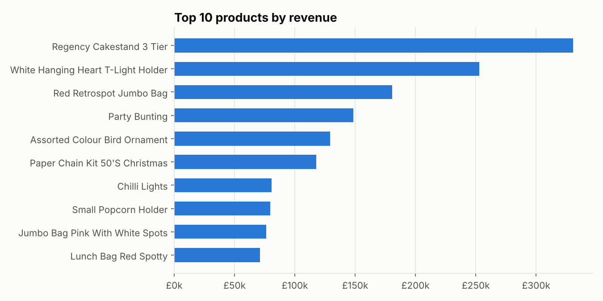

# Online Retail Sales & Customer Analytics (SQL + Python)

End-to-end analysis of **1.07 million real e-commerce transactions** from a UK-based online gift retailer (Dec 2009 – Dec 2011). The goal is to answer business questions that a sales, marketing or CRM team actually asks:

- How is revenue developing, and how seasonal is the business?
- Which markets and products drive revenue?
- Who are our most valuable customers, and who is about to churn? (**RFM segmentation**)
- How many new customers come back? (**cohort retention**)

**Tools:** SQL (SQLite), Python (pandas, matplotlib). All business logic is written in SQL (`sql/`), and Python orchestrates the pipeline, scores customers and draws the charts.

---

## Key findings

| KPI | 2010 | 2011 (to 9 Dec) |
|---|---|---|
| Revenue | £9.34M | £9.21M |
| Orders | 19,626 | 18,220 |
| Active customers | 4,205 | 4,213 |
| Average order value | £476 | £505 (+6%) |

1. **Strong Q4 seasonality.** Revenue roughly doubles from August to November in both years (peak: £1.45M in Nov 2011). Stock, staffing and marketing budgets should be planned around Sep–Nov.
2. **Heavy dependence on the UK.** The UK accounts for **85% of revenue**. The largest export markets are Ireland, the Netherlands, Germany and France. Ireland generates 3.2% of revenue from only 3 customers, a key-account risk.
3. **A quarter of customers generate 70% of revenue.** The *Champions* segment (25% of customers, bought recently and often) brings in 70% of revenue, so retaining them is the top priority.
4. **£1.5M of historical revenue is at risk.** 828 *At-risk* customers used to buy regularly (5 orders on average) but have not ordered for about a year. They are the clearest target for a win-back campaign.
5. **Retention is the main growth lever.** On average only about 21% of a new customer cohort buys again in the following month. Cohorts acquired in Q4 (seasonal shoppers) drop off faster: only 9–13% are still buying three months later, compared with 24–32% for the Jan–Mar 2010 cohorts.
6. **Cancellations are notable in some export markets.** Germany (28% of invoices) and Ireland (22%) have far higher cancellation rates than the UK (15%), which is worth investigating with operations.

### Charts







---

## Method

**1. Data cleaning (`sql/01_clean.sql`)**, which keeps 94% of the 1,067,371 raw rows:
- removed cancelled invoices (invoice numbers starting with `C`), non-positive quantities and prices
- removed non-product lines (postage, bank charges, Amazon fees, manual adjustments, test codes)
- removed exact duplicate rows
- removed bulk orders that were fully reversed by a matching cancellation (same customer, product and quantity). Without this step, two one-off orders of 80,995 and 74,215 units would have appeared among the top products even though they were never really sold.

**2. Analysis queries (`sql/02`–`08`)** cover yearly KPIs, monthly trend, revenue by country, top products, RFM base table, monthly cohorts and cancellation rates. They use CTEs, conditional aggregation and date arithmetic.

**3. RFM segmentation (`src/analysis.py`)**: each customer gets a 1–5 score (quintiles) for **R**ecency (days since last order), **F**requency (number of orders) and **M**onetary value (total spend). The scores are mapped to six actionable segments: Champions, Loyal, New/promising, Need attention, At risk, Lost/hibernating.

**4. Cohort analysis**: customers are grouped by the month of their first purchase. The heatmap shows what share of each cohort purchased again 1–12 months later.

### Limitations
- The data starts in Dec 2009, so the 2009-12 "cohort" also contains customers who had bought before. Its high retention is partly an artefact.
- December 2011 is only partly covered (to 9 Dec), so it is excluded from the monthly trend.
- About 23% of transaction lines have no customer ID. They count towards revenue but not towards customer-level analyses.

### Recommendations
1. **Win-back campaign** for the 828 *At-risk* customers (personal offer, reminder of previously bought products).
2. **VIP programme** for *Champions* (early access to the Q4 range, volume discounts) to protect 70% of revenue.
3. **Second-purchase journey** for new customers in the first 30 days, especially those acquired in Q4.
4. **Diversify export markets** (DACH, Benelux, France) to reduce the dependence on the UK and on single key accounts.

---

## How to run

```bash
pip install -r requirements.txt
# 1. Download "Online Retail II" from the UCI Machine Learning Repository:
#    https://archive.ics.uci.edu/dataset/502/online+retail+ii
# 2. Convert both sheets of the Excel file into data/online_retail_II.csv:
python src/convert_excel.py data/online_retail_II.xlsx
# 3. Run the pipeline (about 20 seconds):
python src/analysis.py
```
Results are written to `outputs/tables/` (CSV) and `outputs/charts/` (PNG).

## Repository structure
```
sql/        SQL queries (cleaning + analysis)
src/        Python pipeline and Excel-to-CSV helper
outputs/    result tables and charts
```

**Data source:** Chen, D. (2012). *Online Retail II* [Dataset]. UCI Machine Learning Repository. CC BY 4.0.
